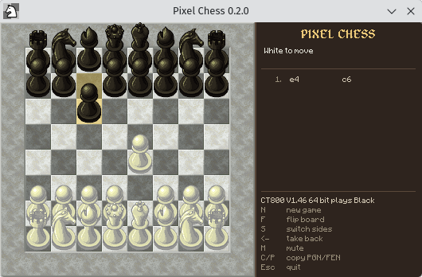

# Pixel Chess

A pixel-art chess game written in Free Pascal with SDL3. Play against a friend on the same computer, or against a UCI chess engine.



## Features

- Full chess rules: castling, en passant, promotion, checkmate, stalemate, fifty-move rule, repetition and insufficient material
- Move list in standard algebraic notation
- Nine graphical themes
- Computer opponent: the bundled Alouette engine, or any engine supporting the UCI protocol

## Requirements

- [Free Pascal](https://www.freepascal.org/) 3.2 or later
- [SDL3](https://libsdl.org/) 3.4 or later and [SDL3_ttf](https://github.com/libsdl-org/SDL_ttf) libraries
- [SDL3-for-Pascal](https://github.com/PascalGameDevelopment/SDL3-for-Pascal) units, cloned next to this repository (`../sdl3-for-pascal`)

## Building

```sh
git clone https://github.com/PascalGameDevelopment/SDL3-for-Pascal.git ../sdl3-for-pascal
make
```

`make clean` removes the build output.

## Usage

```sh
./pixelchess
```

The theme, the window size and the computer opponent are set in `pixelchess.ini`, next to the executable:

```ini
[display]
theme=bftc
scale=1

[engine]
path=engines/alouette/alouette
movetime=1000

[sound]
enabled=1

[log]
uci=0
```

- `theme`: one of `bftc` (default), `deepbasic`, `fritz`, `lanea`, `lucas`, `m484`, `owl`, `smirf`, `warlord`
- `scale`: the window size factor, `1` (default) for the native size. With `2`, every pixel is drawn as a 2×2 square. If the window does not fit on the screen, the largest scale that fits is used instead.
- `path`: the executable of a UCI engine, absolute or relative to the directory of `pixelchess`. By default, the bundled [Alouette](engines/alouette/README.md) engine, built by `make`. Leave it empty to have both sides played by humans.
- `movetime`: the engine's thinking time per move, in milliseconds (default `1000`).
- `enabled`: `1` (default) to play sounds, `0` to start muted.
- `uci`: `1` to record the dialogue with the engine in the log file, `0` (default) otherwise.

If the file is missing, it is created with the default values.

These settings can also be given on the command line, which overrides `pixelchess.ini` for that session without modifying it:

```sh
./pixelchess --theme=fritz
./pixelchess -t lucas -s 2
./pixelchess --engine=/usr/games/stockfish --movetime=3000
./pixelchess -e ../engines/ct800 -m 500 -t m484
./pixelchess --engine=
./pixelchess --fen="4k3/8/8/8/8/8/8/4K2R w K - 0 1"
./pixelchess --help
```

On the command line, a relative engine path is resolved from the current directory. An empty path (`--engine=`) disables the computer opponent set in `pixelchess.ini`. `--fen` (or `-f`) starts the game, and every new game, from the given position.

## Controls

| Key / action      | Effect                                  |
|-------------------|-----------------------------------------|
| Click or drag     | Move a piece                            |
| `N`               | New game                                |
| `F`               | Flip the board                          |
| `S`               | Switch sides (when playing the engine)  |
| `Backspace`       | Take back a move                        |
| `M`               | Mute or unmute sounds                   |
| `C`               | Copy the game (PGN)                     |
| `P`               | Copy the position (FEN)                 |
| `Esc`             | Cancel a promotion, or quit             |

## Credits

- Engine: [Alouette](engines/alouette/README.md) by Roland Chastain (0BSD)
- Fonts: Alagard by Hewett Tsoi, Minecraftia
- Themes:
  - `bftc`: pieces from *Bobby Fischer Teaches Chess*
  - `deepbasic`: pieces from the *Deep Basic* chess program by Thomas McBurney
  - `fritz`: pieces and board reproducing those of the Fritz chess program (ChessBase)
  - `lanea`: [Boardgame tiles](https://opengameart.org/content/boardgame-tiles) by Lanea Zimmerman
  - `lucas`: [Pixel chess pieces](https://opengameart.org/content/pixel-chess-pieces) by Lucas312
  - `m484`: [M484 chess set](https://opengameart.org/content/m484-chess-set) by Master484 (CC-BY 4.0 / OGA-BY 4.0)
  - `owl`: pieces from the *OWL Chess* demo program by Borland International
  - `smirf`: [pieces](https://www.chessvariants.com/contests/10/crc.html) by Reinhard Scharnagl
  - `warlord`: pieces from the [Warlord](https://chessprogramming.org/Warlord) chess program by William H. Rogers

## License

Pixel Chess is free software, released under the GNU General Public License v3. See [LICENSE](LICENSE).
